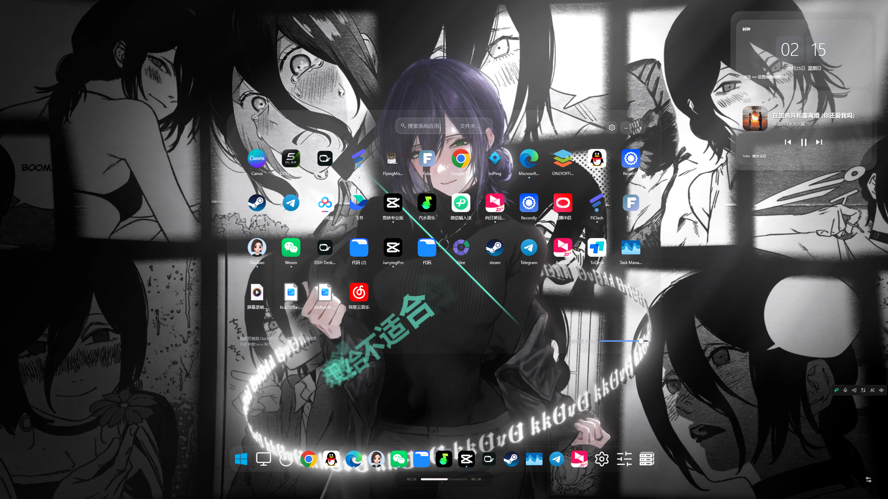

# GlassBoard-Source v0.9.21.11

一个运行在 Windows 10/11 上的免费桌面启动台——毛玻璃 Dock 栏、应用面板、控制中心、桌面组件、灵动岛、壁纸引擎，一次装齐。



## 功能一览

- **Dock 栏**：固定常用软件，一键启动、再点最小化，多窗口自动切换置顶；悬停预览窗口列表；4 套内置图标风格，支持自定义图标与右键菜单即系统右键菜单；运行指示圆点；点击波纹动效；一键隐藏/显示桌面图标与游戏模式快捷开关。
- **应用面板**：自动收纳桌面程序；顶部系统级搜索框，开始菜单应用、注册表程序、磁盘文件流式秒出。
- **控制中心**：WiFi 连接管理、蓝牙设备管理、音量、静音、亮度、输出设备切换，连接过的 WiFi 免密直连。
- **桌面组件**：时钟（时/分/秒）、音乐组件（识别网易云、QQ 音乐、酷狗、酷我、汽水音乐等，支持播放/暂停/切歌/封面）。
- **灵动岛**：收起态显示曲目/封面/电量/通知角标/音乐频谱跳动条；展开面板含音乐页、通知页、剪贴板历史（开机存活、点击即复制）、随手记（标题/内容/提醒时间/待办/导出）、控制页；宽度/高度自由调节，跟随全局面板主题，可选置顶。
- **壁纸引擎**：本地壁纸库 + 官方图库，支持填充/适应/拉伸/居中/平铺，一键还原系统壁纸；**支持自定义视频动态壁纸**（mp4/webm 等，循环播放、音量/静音可调，基于 WebView2 内核）。
- **推荐配置导入**：发布包里自带 `DefaultConfig.json`，首次打开会询问"是否使用推荐配置"——只导入外观与布局设置，不覆盖图标，导入后自动改名为 `DefaultConfig.json.done`。

无广告、不联网更新、不收集任何数据，所有内容都在本地。

## 使用提示

- **音乐识别不到？** 请到音乐软件的系统设置里开启「信息同步」（系统媒体信息/播放信息同步）。音乐组件依赖系统媒体会话识别正在播放的歌曲，音乐软件关闭该同步后无法获取曲目、封面和播放状态。

## 构建

> **无需编译也能用**：仓库根目录就是编译好的便携版。拉取仓库后直接双击根目录的 `GlassBoard.exe` 即可运行，无需下载发布包，也无需安装 .NET SDK。

如需从源码构建（面向开发者）：

- 目标框架：.NET Framework 4.8（SDK 风格 csproj，WPF + WinForms，LangVersion 14）
- 依赖：`src\lib\Interop.UIAutomationClient.dll`（已随仓库提供）
- 视频动态壁纸依赖：`Microsoft.Web.WebView2` NuGet 包（构建自动还原），发布目录需含 `WebView2Loader.dll`（x64，已随仓库提供于 `lib\`）及 `Microsoft.Web.WebView2.*.dll`；运行端需要系统已安装 WebView2 运行时（Win10/11 通常自带）
- 嵌入资源：`GlassBoard.MediaBridge.ps1`、`GlassBoard.NativeMediaBridge.ps1`、`GlassBoard\ControlCenter.ps1` 及 `GlassBoard\Assets\` 下图片资源
- 发布目录需包含：`lib\NPSMLib.dll`（音乐兼容通道：进度条/拖动/封面补充，缺失时仅系统媒体会话可用）、`data\AppGroups.tsv`（应用自动分组规则）——两者均已随仓库提供，发布时一并复制到程序根目录

```powershell
dotnet build src\GlassBoard.csproj -c Release
```

## 发布说明

本仓库源码对应 v0.9.21.11（程序集版本 0.9.21.11）。仓库根目录直接存放编译好的便携版（拉取即用，双击 `GlassBoard.exe` 运行）；GitHub Release 页面同时提供便携压缩包。源码位于 `src\` 目录，仅供开发者参考与修改。


### v0.9.21.11 更新内容

- 修复：动态壁纸在部分设备上不盖满全屏、显示在左上方——窗口尺寸改用虚拟屏物理像素（125%/150% DPI 缩放不再错位）
- 新增：设置页「卸载 GlassBoard」——自动检索程序位置/数据位置/开机启动项，可选删除配置数据与程序目录
- 优化：Dock 与大面板入口自动记住应用真实位置——桌面快捷方式被移动/删除后入口仍可正常启动
- 新增：入口失效（源文件与目标都不存在）时点击会询问是否移除该入口
- 修复：一键隐藏桌面图标后短暂卡顿甚至无响应——设置变更广播移到后台线程
- 优化：律动组件「双螺旋」样式在无音乐时保持待机波浪流动，不再静止成一条线
- 修复：汽水音乐切歌后歌词行空白（会话重建被误判为位置不可知）——恢复正常逐字高亮
### v0.9.21.10 更新内容

- 修复：程序集缺失时整个灵动岛随音乐频谱初始化一起崩溃（`NAudio.Core` 找不到文件）——频谱 FFT 缓冲改为延迟分配，缺依赖时仅音乐律动/跳动条静默降级，灵动岛其余功能不受影响
- 修复：动态壁纸启动失败弹窗提示查看 error.log，但失败记录只写在 session.log，日志里找不到对应条目——失败信息现在同时写入 session.log 与 error.log，提示与实际一致
- 修复：Win10 未安装 WebView2 运行时启动动态壁纸只报笼统失败——开启前先探测运行时，未安装时直接给出下载地址与安装指引（视频动态壁纸依赖 WebView2，Win10 未安装为常见原因）
- 优化：检查更新时自动携带程序集完整性信息，便于诊断"单独拷贝 exe 缺依赖"的安装

### v0.9.21.9 更新内容

- 音乐律动桌面组件新增 5 套样式并重设计：频谱曲线 / 双螺旋 / 粒子喷泉 / 音轨条带 / 雷达频谱（原环形脉冲、波浪叠层、星尘粒子、律动圆舞保留为前四套）
- 律动组件配色 DIY：10 套配色（极光蓝紫/青绿/粉红/橙金/紫红/绿/红/纯白/彩虹/跟随强调色），右键组件或设置-组件里可切换
- 组件外观 DIY（自定义组件面板）支持律动样式与配色即时切换
- 修复：灵动岛/律动组件采集静默假死（频谱事件停发导致跳动条冻结）——加采集看门狗，断流 2.5 秒自动重建；修复灵动岛与律动组件共享采集的引用计数不对称

### v0.9.21.8 更新内容

- 新增：**自定义视频动态壁纸**——设置 → 壁纸设置 → 动态壁纸，选择视频文件即设为桌面壁纸，支持循环播放、音量调节、静音；视频窗口挂在桌面壁纸层（图标之下），与系统壁纸/静态壁纸共存。基于 WebView2 内核（Windows 10/11 自带或自动安装），与 Wallpaper Engine 等第三方动态壁纸互斥（检测到自动让位）
- 修复：面板（应用面板/控制中心/灵动岛）点击外部收不起来的顽疾——全局鼠标钩子里 9 个系统 API 的入口名写错，异常被静默吞掉，导致"点击位置是否在本程序窗口"判定永远失效；全部修正后点击外部收起恢复正常
- 修复：启动时任务栏被隐藏会引发的空引用崩溃（应用面板延迟创建与任务栏隐藏的时序冲突）
- 修复：隐藏任务栏的残留问题——程序被强制结束（任务管理器/杀软）时退出清理不执行，任务栏会一直处于隐藏状态；现启动时自动检测：设置里隐藏任务栏未开启但任务栏实际处于隐藏状态，自动恢复显示
- 优化：视频/动态壁纸窗口不抢焦点（点击壁纸不会再触发系统提示音；若系统提示音与壁纸无关，请重启资源管理器 explorer 解决——长时运行后桌面壳层状态损坏属 Windows 已知现象）
- 移除：开发期诊断日志（逐点击/逐事件写日志），session.log 更干净

### v0.9.21.7 更新内容

- 修复：通知卡（QQ 等）内容被截掉一半——事件卡窗口固定用收起态高度，三行文字（应用名/昵称/内容）装不下；改为按内容自适应加高（上限 +120px）、标题过长时加宽（上限 +160px），三行文字改左对齐
- 修复：字体颜色与岛的主题不一致（设置深色主题字体仍是黑色）——文字颜色改为跟随岛的实际底色模式：跟随系统主题按系统明暗，手动模式按岛的深浅设置，深色背景白字、浅色背景黑字
- 通知图标：恢复圆形背景；未读标记改为红点，位于圆形背景内部右上角（不再显示数字）；无通知时图标整块隐藏
- 修复：收起态宽度适配不稳定（铃铛/专注芯片显隐后宽度时好时坏）——窗口收缩动画落位后自动补跑一次宽度适配
- 专注模式设置从设置页移入灵动岛：点收起态的专注磁贴即可设置专注时长、休息时长与结束提醒方式

### v0.9.21.6 更新内容

- Dock 悬停放大引擎全面重写为帧驱动（15ms 渲染级定时器）：指数平滑随真实帧间隔自适应、放大方向限速 8 倍/秒、快速滑过后图标立即回落（缩小不限速），连续扫动/快甩无卡顿、无悬空
- 放大改窗口级邻近放大：光标到各图标中心的距离按平滑阶梯曲线（smoothstep）计算放大，相邻图标被局部推开——不再需要逐个图标进出动画，滑动全程连续跟手
- 修复：悬停左端会带动最右端图标（按构建顺序推邻居，视觉顺序不一致）；修复图标锚点在窗口动画期间被错误捕获导致「悬停图标不放大、悬停空白处放大」——锚点改为每帧重捕获
- 悬停放大倍数上限由 1.6 提升至 2.0，固定显示数量上限由 20 提升至 30
- 修复：强制结束进程时图标缓存可能留下半截 PNG 导致图标显示为方块（改为临时文件 + 原子替换写入，损坏文件自动删除重建）

- 修复：安装路径含中文（如 `D:\软件\...`）时，在线更新完成后无法自动重启，报「Windows 找不到文件 D:\??\GlassBoard-Source\GlassBoard.exe」且更新未落盘（根因：重启脚本按 ASCII 编码写出，非 ASCII 路径被替换成 `??`；改为路径经环境变量以 Unicode 传入，脚本本体保持纯 ASCII）
- 注意：仍在使用 0.9.21.3/0.9.21.4 且安装路径含中文的用户，本次在线更新同样会在重启阶段失败——请手动下载本包覆盖一次，之后所有在线更新恢复正常

### v0.9.21.4 更新内容

- 性能：Apple 玻璃实时模糊（LiveBlur）重捕与烘焙移出 UI 线程，避免低配机卡顿
- 性能：Dock/桌面组件/灵动岛三个玻璃窗口共享一次壁纸层捕获，静态壁纸整屏渲染结果缓存复用
- 性能：大屏（≥300 万像素区域）或软件渲染环境自动降级为静态烘焙并把实时刷新降到 5fps
- 修复：发布包补齐 data\AppGroups.tsv、DefaultConfig.json（首启推荐配置）、licenses\、说明.txt、wallpapers\（0.9.21.3 曾漏打，新装用户应用自动分组与推荐配置导入失效）

### v0.9.21.2 更新内容

- 修复：灵动岛开关不起作用（托盘菜单开关旧实现只开不关，强制把开关改回开启）
- 修复：关闭后再开启会同时出现两个灵动岛（已关闭窗口引用残留 + 看护重建导致多实例）
- 新增：进入游戏模式时弹出确认提示（说明组件会隐藏、退出走托盘），灵动岛在游戏模式下自动隐藏
- 新增：托盘菜单灵动岛入口改为真开关（开↔关翻转）

### v0.9.21.1 更新内容

- 修复：灵动岛在未开启「保持在窗口最上方」时依然浮在所有窗口上方（根因：窗口样式切换时误用 HWND_TOPMOST 直接改置顶位，绕过 WPF 属性管理，现已改为仅重排 Z 序并加双检自愈）
- 修复：全局快捷键（Ctrl+Alt+空格/E/S/R/H/T/A 等）全部失灵（根因：Win+D 防护的窗口句柄预创建把热键注册事件提前到构造器内部触发，订阅错过事件，现已移除预创建）
- 修复：显示桌面（Win+D）后 Dock/桌面组件被盖住的防护状态机在特定窗口排列下卡死不恢复

### v0.9.21.0 更新内容

- 灵动岛与壁纸功能对新用户默认关闭，可在设置中一键开启
- 灵动岛出厂默认采用官方推荐配置（圆角矩形、频谱曲线跳动条、推荐尺寸比例）
- 更新提示区分「主更新」（版本号更高）与「次更新」（同版本号新构建）
- Dock 图标点击波纹默认开启
- 修复：动态壁纸背景下组件背景捕获显示系统壁纸；大面板展开显示纯玻璃（无背景捕获）；灵动岛收缩动画抖动；Win+D 显示桌面时 Dock/组件被盖；Win10 任务栏兼容（黑屏/崩溃防护）；剪贴板历史开机存活；随手记页签被通知页挤出等

## 许可

详见 `THIRD_PARTY_NOTICES.md` 与 `licenses\` 目录。
