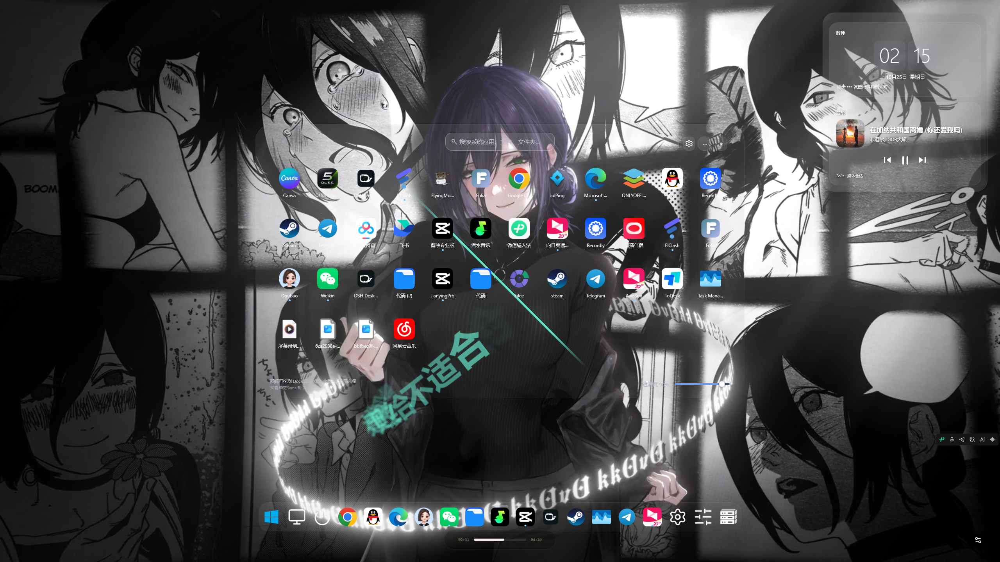

# GlassBoard-Source v0.9.20.0

一个运行在 Windows 10/11 上的免费桌面启动台——毛玻璃 Dock 栏、应用面板、控制中心、桌面组件，一次装齐。



## 功能一览

- **Dock 栏**：固定常用软件，一键启动，再点最小化，多窗口自动轮换置顶；悬停预览窗口列表；4 套内置图标风格，支持自定义图标；右键菜单即系统右键菜单。
- **应用面板**：自动分组收纳桌面程序；顶部系统级搜索框，开始菜单应用、注册表程序、磁盘文件流式秒出。
- **控制中心**：WiFi 连接管理、蓝牙设备管理、音量、静音、亮度、输出设备切换，连接过的 WiFi 免密直连。
- **桌面组件**：时钟（时:分:秒）、音乐组件（识别网易云、QQ 音乐、酷狗、酷我、汽水音乐等，支持播放/暂停/切歌/封面）。
- **推荐配置导入**：发布包里自带 `DefaultConfig.json`，首次打开会询问"是否使用推荐配置"——只导入外观与布局设置，不覆盖图标，导入后自动改名为 `DefaultConfig.json.done`。

无广告、不联网更新、不收集任何数据，所有内容都在本地。

## 使用提示

- **音乐识别不到？** 请到音乐软件的系统设置里开启「信息同步」（系统媒体信息/播放信息同步）。音乐组件依赖系统媒体会话识别正在播放的歌曲，音乐软件关闭该同步后无法获取曲目、封面和播放状态。

## 构建

> **无需编译也能用**：仓库根目录就是编译好的便携版。拉取仓库后直接双击根目录的 `GlassBoard.exe` 即可运行，无需下载发布包，也无需安装 .NET SDK。

如需从源码构建（面向开发者）：

- 目标框架：.NET Framework 4.8（SDK 风格 csproj，WPF + WinForms，LangVersion 14）
- 依赖：`src\lib\Interop.UIAutomationClient.dll`（已随仓库提供）
- 嵌入资源：`GlassBoard.Assets.c1.dat`、`c2.dat`、`GlassBoard.MediaBridge.ps1`、`GlassBoard.NativeMediaBridge.ps1`、`GlassBoard\ControlCenter.ps1` 及 `Assets\` 下图片资源
- 发布目录需包含：`lib\NPSMLib.dll`（音乐兼容通道：进度条/拖动/封面补充，缺失时仅系统媒体会话可用）、`data\AppGroups.tsv`（应用自动分组规则）——两者均已随仓库提供，发布时一并复制到程序根目录

```powershell
dotnet build src\GlassBoard.csproj -c Release
```

## 发布说明

本仓库源码对应 v0.9.20.0（程序集版本 0.9.20.0）。仓库根目录直接存放编译好的便携版（拉取即用，双击 `GlassBoard.exe` 运行）；GitHub Release 页面同时提供便携压缩包 `GlassBoard-0.9.20.0-portable.zip`。源码位于 `src\` 目录，仅供开发者参考与修改。

## 许可

本项目为免费公益项目，第三方组件许可见 `THIRD_PARTY_NOTICES.md` 与 `licenses\` 目录。
